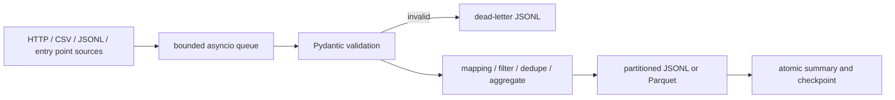

# Architecture

Each source and the queue consumer run in one asyncio TaskGroup. The bounded queue applies backpressure between producers and the consumer; HTTP uses one shared client with connector limits. Source errors are isolated unless fail-fast is selected. Cancellation exits the task group and closes the client. File readers and the queue consumer process incrementally. When no transforms are configured the consumer flushes bounded sink batches; when transforms are configured it retains validated records to preserve whole-run transform semantics. Outputs are grouped by a validated date key and each file is committed by same-directory temporary file plus atomic replacement. Checkpoints use atomic JSON replacement after outputs have been written. This is not a multi-file transaction; an interrupted sink can leave complete files while checkpoints remain unchanged. Per-file replacement is atomic, but a collection of files and summary is not a transaction. A crash after output commits and before checkpoint commit can leave complete output files while the cursor remains behind; resume is therefore at-least-once and may reprocess records. Checkpoints commit at successful run completion, not per batch. Third-party implementations use the `datapipe.sources` entry point group and `SourceRegistry`; configure their entry-point name as source `type` and constructor kwargs in `settings`. HTTP page, CSV data-row and JSONL line cursors resume after normal EOF and successful sink commit. Checkpoints are not per-batch.
