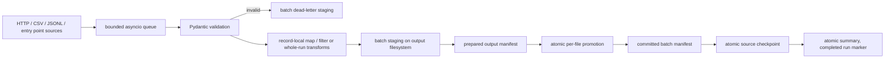

# Architecture

## Async engine and memory

Source producers and the queue consumer run in an `asyncio.TaskGroup`. The bounded queue applies backpressure. HTTP sources share one `aiohttp.ClientSession` with connector limits. Source errors are isolated unless fail-fast is selected. Cancellation closes the HTTP client and stops producers; batches already committed remain available for recovery.

No-transform, mapping-only, filtering-only, and fingerprint-only pipelines process records as they arrive and keep current records bounded by the queue and sink batch size. Mapping, filtering, and fingerprinting are record-local and preserve consumer arrival order. Fingerprinting uses an exact affine recurrence modulo 2^32, calculated by exponentiation by squaring, and no longer loops once per configured round. Deduplication and aggregation still retain valid input for whole-run behavior and therefore use input-proportional memory; disk-backed transform state is not yet integrated with the commit journal.

## Output commit and checkpoint flow

For every output batch, DATAPIPE writes immutable output and dead-letter files under `<output>/.datapipe/staging/<batch-id>`. It atomically persists a prepared manifest entry containing file paths and source cursor watermarks. It promotes each file with same-filesystem `os.replace`, marks the batch committed, then advances the atomic checkpoint. Each file promotion is atomic; a group spanning partitions is not. If a process stops during promotion, the next startup sees the prepared entry, skips destinations already present, promotes remaining staged files, commits the journal, and reconciles checkpoint cursors. If the failure predates the prepared manifest entry, staged artifacts are orphaned and cleaned; the source cursor remains behind and input is replayed.

The manifest is `<output>/.datapipe/manifest.json`. It is config-signature bound and records batches plus run states (`running`, `interrupted`, `completed`). The summary is atomically replaced at run completion; the run is marked completed only after that write. The public `dead-letter.jsonl` file is rebuilt atomically from committed immutable dead-letter batches at successful run completion and startup recovery. Old dead-letter data is preserved when the manifest is initialized over an existing output directory.

Delivery is **at least once**, not exactly once. Output files can be visible in partition paths before every file in a prepared multi-partition batch has been promoted. Consumers requiring complete batch boundaries must use the manifest; there is not yet a dedicated manifest-aware reader. A crash after batch commits but before summary completion leaves the run marked interrupted, while committed data and cursors remain. Directory fsync is not available consistently across platforms, so sudden power loss guarantees depend on the filesystem. An OS advisory lock at `<output>/.datapipe/writer.lock` serializes DATAPIPE writers to one output root. The persistent lock file is not itself evidence of a held lock; the OS releases the lock on process exit. Advisory-lock semantics may not be reliable on some network filesystems, and all cooperating writers must use DATAPIPE's lock.

The transaction lock is acquired before journal recovery, source processing, and checkpoint updates, and released on success, failure, or task cancellation. Lock acquisition times out after 30 seconds. Independent output roots use independent locks. The per-file atomic rename guarantee assumes staging and target paths are on the same filesystem; the sink stages under the output root to satisfy this on ordinary local filesystems.

## Signals and shutdown

The CLI installs SIGINT and SIGTERM handlers where Python permits, cancels the pipeline task, restores previous handlers, and exits with `128 + signal number`. The engine propagates cancellation through its TaskGroup and closes HTTP resources. Work submitted to `asyncio.to_thread` may finish while `asyncio.run` shuts down its executor; a batch is either journaled and recoverable or left as uncommitted staging data. POSIX subprocess tests send real SIGINT and SIGTERM. They are skipped on Windows; no Linux distribution is installed in the current validation host, so real POSIX signals remain unverified locally. On Windows, Ctrl+C can be delivered to an attached console process; `TerminateProcess`-style SIGTERM cannot be caught and relies on next-run recovery.

## Plugins

Third-party source classes are discovered through the `datapipe.sources` entry-point group and registered in `SourceRegistry`. Configure the entry-point name as `type` and constructor arguments under `settings`. A resumable plugin accepts a `cursor` constructor keyword, exposes a cursor watermark that advances to the next item only as each item is yielded, and resumes from that watermark. Plugins without that constructor argument can run, but cannot be resumed by DATAPIPE. Static end-of-source cursors are unsafe for small batch sizes.
